<div align="center">


# aether

**A little universe, entirely yours.**

A browser-local particle artwork: 2,800 luminous points that morph between five 3D worlds,
bend around your pointer, ripple when you click, and hum along to a synthesized ambient soundtrack.

**[▶ Live demo](https://ruvnet.github.io/aether/)** · one self-contained HTML file · no dependencies · everything is drawn live on a `<canvas>`.

</div>

---

## Quick start

```bash
git clone https://github.com/ruvnet/aether.git
cd aether
```

Then either open `index.html` directly in a browser, or serve the folder:

```bash
python -m http.server 4173      # then visit http://127.0.0.1:4173/
# or
npx serve .
```

Sound only starts after you interact with the page (browsers require it), and if your system is set to
*reduce motion*, Aether starts paused.

> The page imports **DM Sans** and **Manrope** from Google Fonts for its typography. If they can't load
> (offline, blocked), it falls back to system fonts and works the same.

## Five worlds

The same 2,800 particles continuously re-form into five shapes. Each particle eases toward its target
position, so switching worlds is a morph, not a cut.

<div align="center">
</div>

| | World | Tagline |
|---|---|---|
|  | **Galaxy** — *The spiral galaxy* | A thousand little lights. One beautifully imperfect orbit. |
| 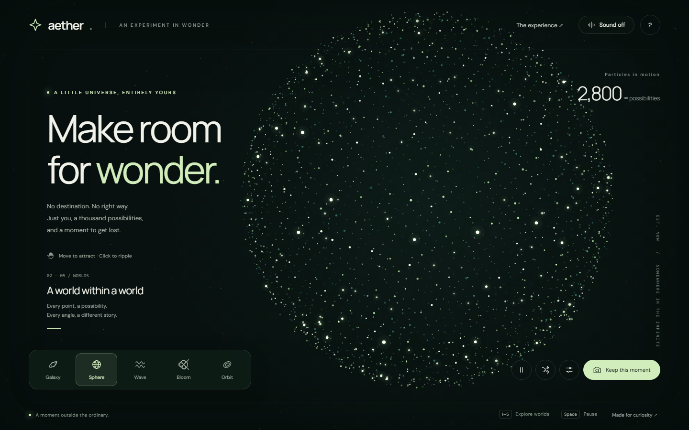 | **Sphere** — *A world within a world* | Every point, a possibility. Every angle, a different story. |
| 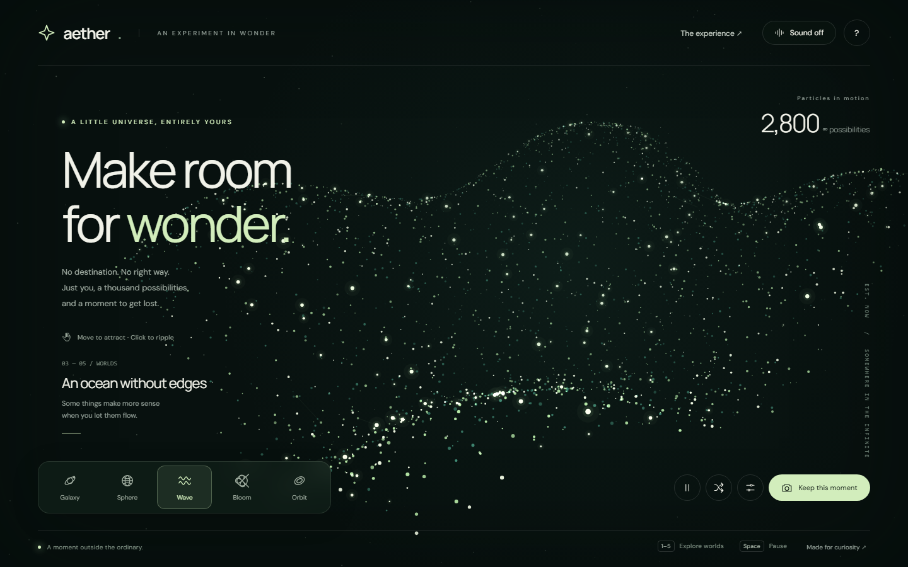 | **Wave** — *An ocean without edges* | Some things make more sense when you let them flow. |
| 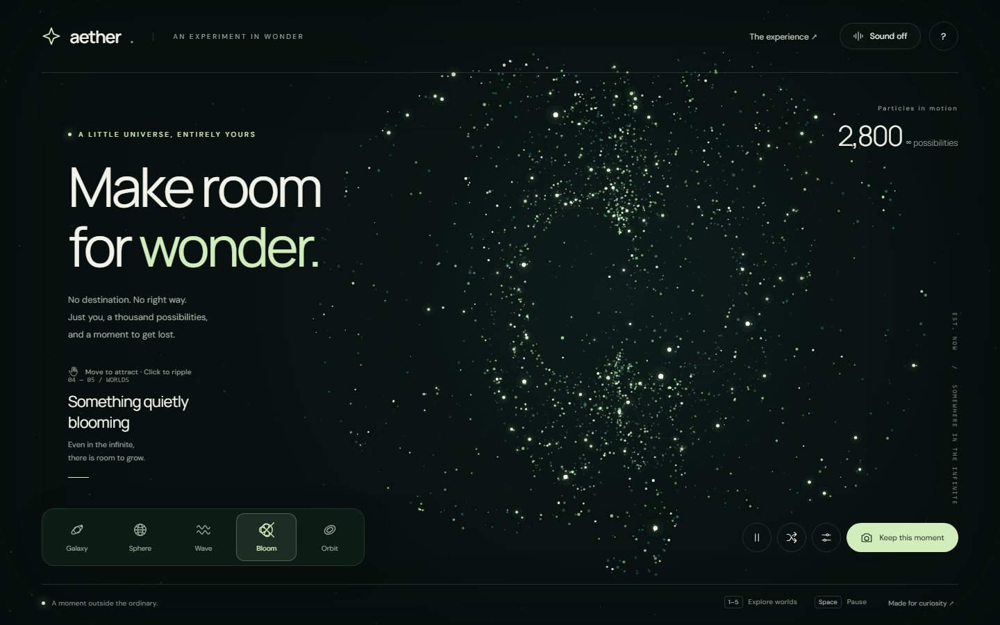 | **Bloom** — *Something quietly blooming* | Even in the infinite, there is room to grow. |
|  | **Orbit** — *The beautiful in-between* | A delicate balance between holding on and letting go. |

## Four atmospheres

Open **Tune your universe** (the sliders button) to change the colour atmosphere, plus how energetic the
motion is and how strongly the particles are pulled toward your pointer.

<div align="center">
</div>

<table>
<tr>
<td>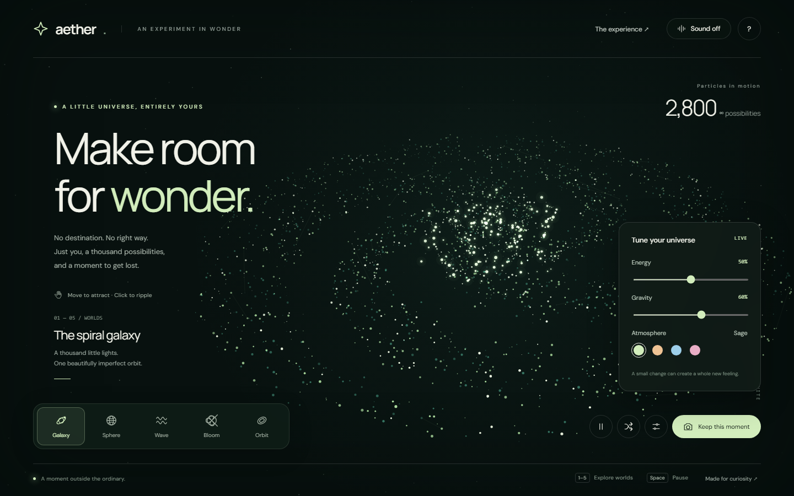<br><sub><b>Tune panel</b> — Energy, Gravity, Atmosphere</sub></td>
<td>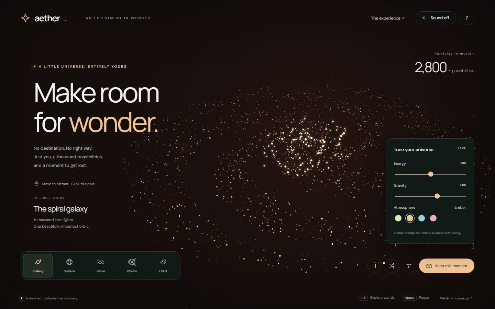<br><sub><b>Ember</b> — galaxy</sub></td>
</tr>
<tr>
<td>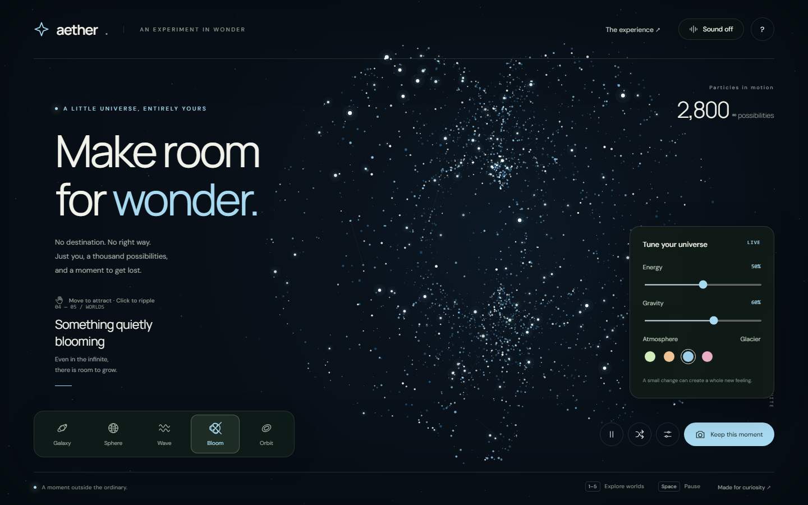<br><sub><b>Glacier</b> — bloom</sub></td>
<td>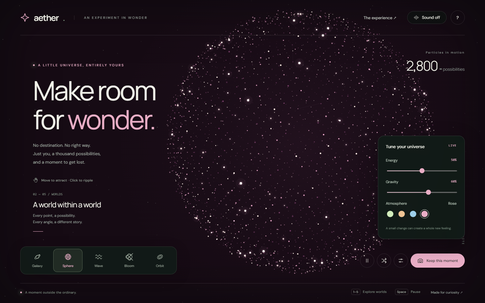<br><sub><b>Rose</b> — sphere</sub></td>
</tr>
</table>

| Atmosphere | Accent |
|---|---|
| Sage | `#d2edbc` |
| Ember | `#efc394` |
| Glacier | `#a7d9f0` |
| Rose | `#e9aec6` |

## Touch the universe

Move the pointer (or touch) and nearby particles drift toward it; press and hold to pull harder. Click or
tap to send a ripple that pushes particles outward as the wave passes through them.

<div align="center">
</div>

<table>
<tr>
<td>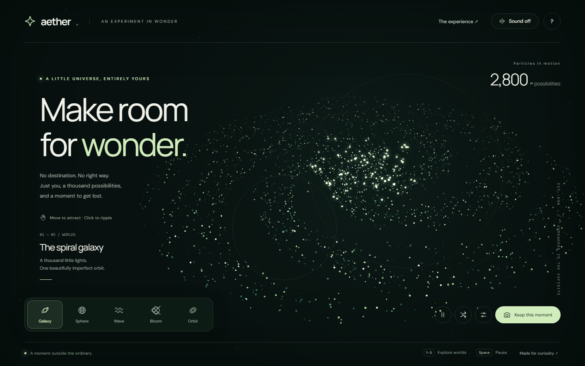<br><sub>Ripples in the live app</sub></td>
<td>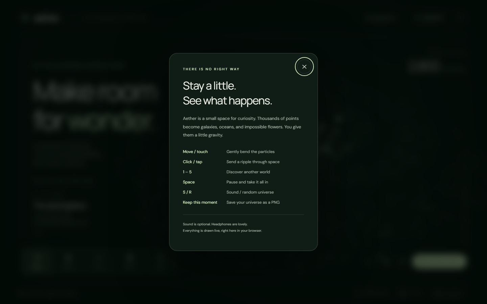<br><sub>The built-in guide (<code>?</code>)</sub></td>
</tr>
</table>

## Controls

| Input | Action |
|---|---|
| Move / touch | Gently bend the particles toward you |
| Click / tap | Send a ripple through space (up to 8 at once) |
| `1` – `5` | Switch world: Galaxy, Sphere, Wave, Bloom, Orbit |
| `Space` | Pause and take it all in |
| `S` | Sound on / off |
| `R` | Discover a random universe (new world, new atmosphere, reshuffled particles) |
| `?` | Open the guide |
| `Esc` | Close the tune panel |
| **Keep this moment** | Save the current frame as a PNG |

Every keyboard control is also a button. **Keep this moment** exports the canvas with a small `aether.`
caption showing the world name and date, as `aether-<world>-<timestamp>.png`.

## On mobile

The layout adapts down to phone widths: the world switcher spans the full width and the secondary labels
tuck away.

<table>
<tr>
<td align="center">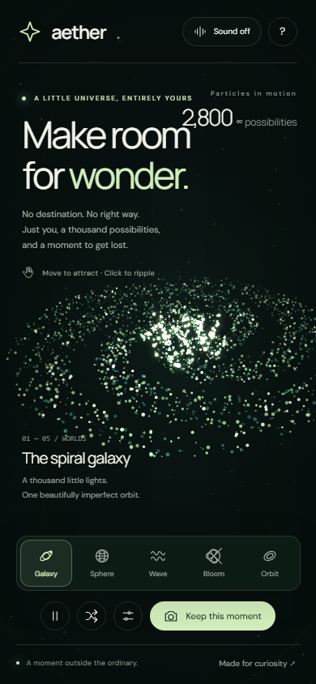</td>
<td align="center">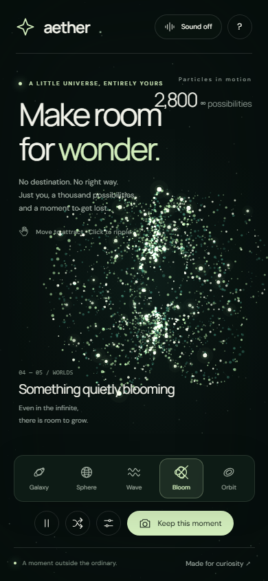</td>
</tr>
</table>

## How it works

- **Rendering** — a single 2D canvas, redrawn every frame. Pixel ratio is capped at 1.75 to keep it
  smooth on high-DPI screens, and drawing pauses while the tab is hidden.
- **Particles** — 2,800 points, each with fixed random attributes. A `target()` function maps every
  particle to a position for the current world (a four-armed spiral, a Fibonacci sphere, a
  travelling sine surface, a lobed bloom, a torus-like ring). Particles ease toward their
  target at 4.5% per frame, which is what makes the morph.
- **Depth** — positions are rotated, then perspective-projected; size and brightness scale with depth,
  and points are depth-sorted and drawn with additive blending so dense regions glow.
- **Pointer gravity** — a Gaussian falloff pulls nearby particles toward the pointer, scaled by the
  Gravity slider (stronger while pressed).
- **Ripples** — each ripple is an expanding ring; particles near the ring's edge are pushed radially
  outward, fading over about 2.6 seconds.
- **Sound** — optional and off by default. Four low sine oscillators form a soft drone through a
  low-pass filter, and short chimes play on world changes and clicks. Audio is suspended when the tab
  is hidden.
- **Accessibility** — the canvas has a descriptive label, controls are real buttons with labels and
  pressed states, focus is visible, and `prefers-reduced-motion` starts the scene paused.

## Project layout

```
aether/
├── index.html          # single-file build of the app (generated; this is what GitHub Pages serves)
├── src/
│   ├── index.html      # markup
│   ├── styles.css      # all styling, including responsive and reduced-motion rules
│   └── app.js          # particles, worlds, rendering, audio, controls
├── scripts/
│   ├── build.mjs           # inlines src/ into the root index.html
│   ├── generate-svgs.mjs   # generates the animated SVGs in docs/svg/
│   └── screenshots.mjs     # captures docs/screenshots/ with headless Chrome
├── docs/
│   ├── svg/            # animated SVGs used in this README
│   └── screenshots/    # screenshots of the running app
└── package.json
```

## Development

Edit the files in `src/`. You can open `src/index.html` directly in a browser while you work: it
loads `styles.css` and `app.js` alongside it. When you're done, regenerate the single-file build:

```bash
npm run build          # src/ → index.html (no dependencies, just Node)
```

The README's media can be regenerated too:

```bash
npm run svgs           # rewrites docs/svg/*.svg
npm run screenshots    # rewrites docs/screenshots/*.png (needs Node 22+ and Chrome; set CHROME_PATH if needed)
```

Commit the rebuilt `index.html` along with your `src/` changes, since that's the file the live site
serves.

## Browser support

Any current browser with Canvas 2D support. Ambient sound additionally needs the Web Audio API; if it's
unavailable the page says so and carries on silently.

---

<div align="center"><sub>Made for curiosity. Headphones are lovely.</sub></div>
